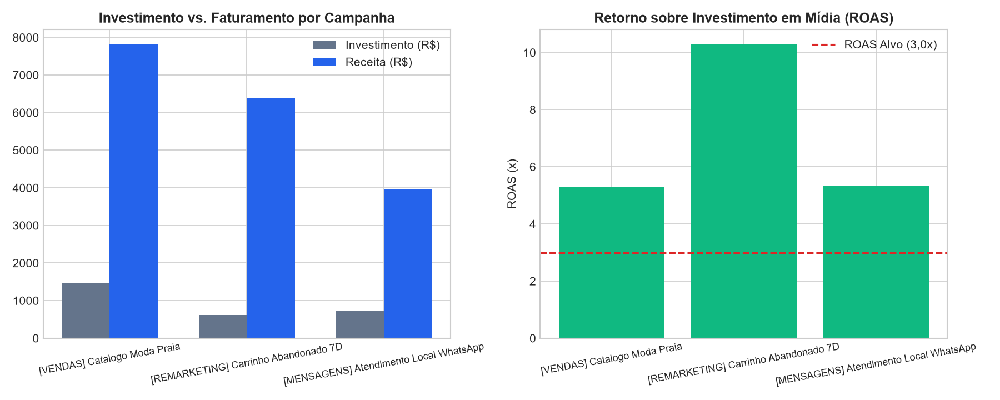

# Business Intelligence para Tráfego Pago (Meta Ads API & Relatórios Automatizados)


> **Nota de Anonimização & Segurança:** Todos os tokens de acesso, IDs de contas de anúncios, pixels, URLs de webhooks e dados de clientes reais foram substituídos por variáveis de ambiente (`.env.example`) e uma base sintética de demonstração (`data/sample_campaigns_insights.json`).

## Funcionalidades

1. **Extração & KPI Engine (`src/meta_ads_bi.py`):** Conecta à Graph API v20.0 (ou executa em modo `--demo`) para consolidar **Investimento, CPM, CTR, CPC, Adições ao Carrinho (ATC), Checkouts (IC), Compras, CPA, Custo por Conversa e ROAS**.
2. **Automação de Relatório & Webhook:** Gera relatório executivo formatado pronto para envio automatizado ao WhatsApp via n8n/Webhook e exporta `outputs/metricas_consolidadas.csv`.
3. **Clonador Modular de Campanhas (`src/campaign_duplicator_template.py`):** Estrutura programática para replicar campanhas, conjuntos (*adsets*) e criativos entre contas em estado `PAUSED`.

---

## Como Executar (Modo Demonstração)

```bash
pip install -r requirements.txt
python src/meta_ads_bi.py
```

Para executar com conta real localmente, copie `.env.example` para `.env`, configure `META_ACCESS_TOKEN` e rode `python src/meta_ads_bi.py --live`.

## Amostra Visual



---

**Autor:** [Jonathan Campos Cusandei](https://www.linkedin.com/in/jonathancusandei/) · [Portfólio Executivo](https://jonathancusandei-glitch.github.io/portfolio-jonathan/)
